# Adamant User Manual

Adamant turns a metadata schema into a web form. You pick a schema, fill in the form, and Adamant checks your entries as you go. When you are done, you can download your data or send it straight to NextCloud or eLabFTW.

This manual covers Adamant v1.4.1.

---

## Contents

1. [Getting Started](#1-getting-started)
2. [Loading a Schema](#2-loading-a-schema)
3. [Filling In the Form](#3-filling-in-the-form)
4. [Saving and Restoring Your Work](#4-saving-and-restoring-your-work)
5. [Reviewing and Submitting](#5-reviewing-and-submitting)
6. [Editing a Schema](#6-editing-a-schema)
7. [Connecting NextCloud and eLabFTW](#7-connecting-nextcloud-and-elabftw)
8. [Field Types](#8-field-types)

---

## 1. Getting Started

When you open Adamant, you see the home screen.

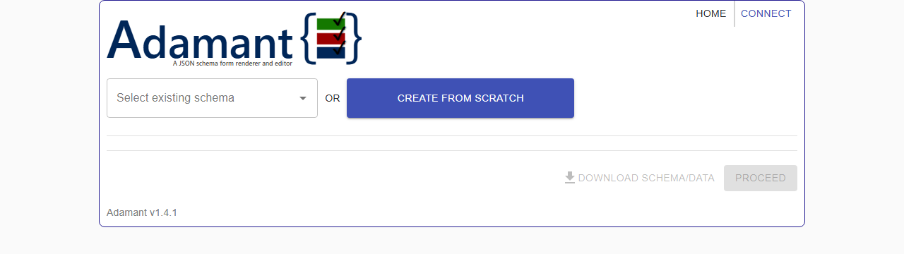

| Element | What it does |
|---|---|
| **Select existing schema** | Choose the schema you want to fill in. See [Section 2](#2-loading-a-schema). |
| **CREATE FROM SCRATCH** | Start with an empty schema and build your own form. |
| **HOME** (top right) | Reloads the page. The current form and any unsaved entries are cleared. |
| **CONNECT** (top right) | Connect your NextCloud or eLabFTW account. See [Section 7](#7-connecting-nextcloud-and-elabftw). |

**Status messages.** A green message, *"Connection to server is established"*, appears in the bottom-right corner when Adamant is fully available. If you instead see *"Unable to establish connection to server"*, Adamant is running in a limited mode: you can still load the built-in schemas or a file from your computer, fill in and edit forms, and download your work, but you cannot connect to NextCloud or eLabFTW, load a schema from a URL, or submit.

**Loading indicator.** A small *"Loading..."* badge appears in the bottom-right corner while Adamant is busy, for example while fetching a list of schemas or uploading files. It disappears on its own when the task is finished.

---

## 2. Loading a Schema

### 2.1 The Schema Selector

Click **Select existing schema**. The list is grouped by where the schema comes from:

| Group | What it contains |
|---|---|
| **Default** | Example schemas that come with Adamant. |
| **NextCloud** | Schemas from your NextCloud account, plus **Browse NextCloud...** |
| **eLabFTW** | Schemas from your eLabFTW account, plus **Browse eLabFTW...** |
| **Browse local file...** | Opens a schema file from your computer. |
| **Load schema from URL...** | Opens a schema from a web link. |

Hover over a group name to see its contents. The NextCloud and eLabFTW groups appear grayed out until you connect that account, and turn bold once you are connected.

You can also type into the box to search across all groups. Each time you reopen the list, the search is cleared so that every schema is shown again.

### 2.2 Example Schemas

Hover over **Default** and click a schema name to load it.

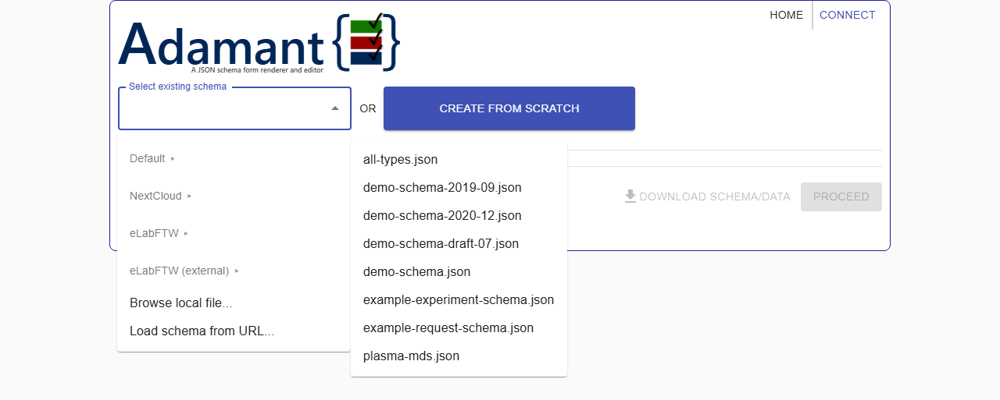

These example schemas are a good way to try out Adamant. Your institution may have added its own schemas to this list.

### 2.3 A File from Your Computer

Click **Browse local file...** and choose a `.json` schema file. If the file is not a valid schema, Adamant shows an error message instead of a form.

### 2.4 A Schema from a Web Link

Click **Load schema from URL...**.

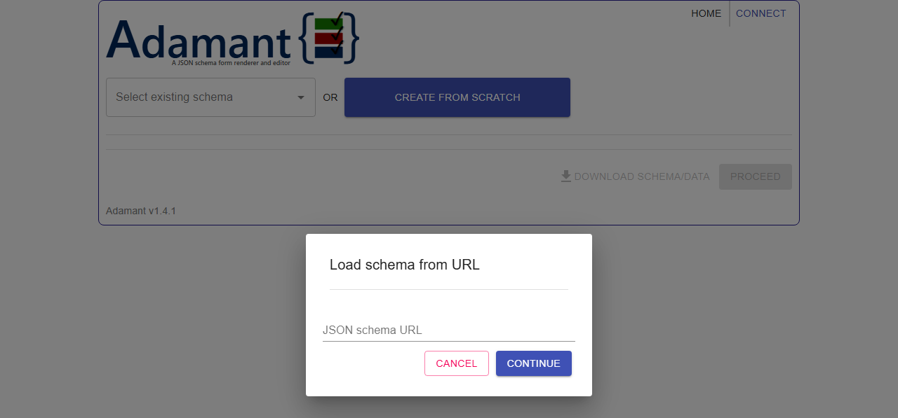

Paste the link to the schema file and click **Continue**. This is useful when a colleague shares a schema as a link rather than as a file.

### 2.5 From NextCloud or eLabFTW

After you connect an account (see [Section 7](#7-connecting-nextcloud-and-elabftw)), hover over its group to see the schemas available there. To look through your folders or experiments yourself, click **Browse NextCloud...** or **Browse eLabFTW...**.

If you connected a different eLabFTW instance than your institution's, use **Browse eLabFTW...** to find your schema.

<!-- Screenshot to retake: schema selector with NextCloud and eLabFTW connected (groups shown in bold). -->

### 2.6 Starting from Scratch

Click **CREATE FROM SCRATCH**. Adamant opens an empty form with Edit Mode already switched on, so you can start adding fields straight away.

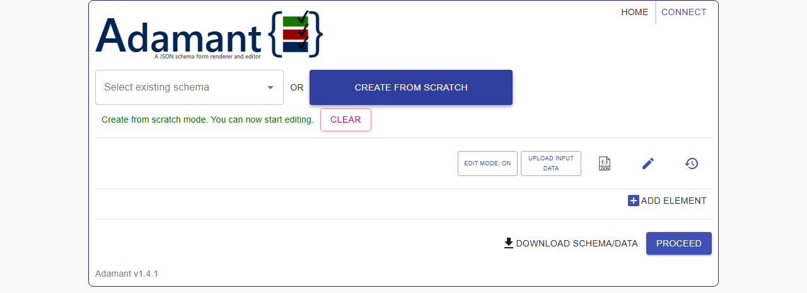

A green message confirms *"Create from scratch mode. You can now start editing."* Click **CLEAR** to throw everything away and start again. To add fields, see [Section 6.2](#62-adding-a-field).

---

## 3. Filling In the Form

Once a schema is loaded, it appears as a form.

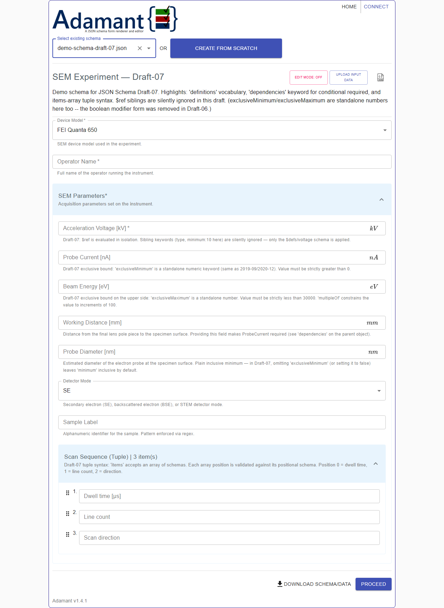

- Each field has a **label** and, underneath, a short **description** explaining what to enter.
- Fields marked with an asterisk (\*) are **required**.
- Depending on the field, you type text or a number, choose from a list, tick a checkbox, or pick a file. See [Section 8](#8-field-types).
- Grouped fields appear in **sections** that you can expand and collapse.
- If a field has a unit, such as **[kV]**, the unit is shown inside the input box.

Above the form you find the schema's title and description, plus these buttons:

| Button | What it does |
|---|---|
| **EDIT MODE: OFF / ON** | Switches Edit Mode on or off. See [Section 6](#6-editing-a-schema). |
| **UPLOAD INPUT DATA** | Fills the form with data you saved earlier. See [Section 4.2](#42-restoring-saved-data). |
| **JSON icon** | Shows the schema behind the form, read-only. You can copy it from there. |

At the bottom of the form are **DOWNLOAD SCHEMA/DATA** ([Section 4.1](#41-downloading)) and **PROCEED** ([Section 5](#5-reviewing-and-submitting)).

---

## 4. Saving and Restoring Your Work

Adamant does not save your entries automatically. To keep your work, download it before you leave the page.

### 4.1 Downloading

Click **DOWNLOAD SCHEMA/DATA** at the bottom of the form.

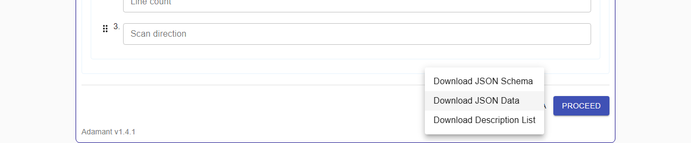

| Option | What you get |
|---|---|
| **Download JSON Data** | Your entries, as a file you can load again later. |
| **Download JSON Schema** | The schema itself, including any changes you made in Edit Mode. |
| **Download Description List** | A readable summary of every field and its value, handy for reports or lab notebooks. |

### 4.2 Restoring Saved Data

1. Load the **same schema** you used when you saved the data.
2. Click **UPLOAD INPUT DATA**.
3. Choose where the data file is:

| Option | Source |
|---|---|
| **Local file** | A data file on your computer. |
| **NextCloud** | A data file in your NextCloud account. Requires a NextCloud connection. |
| **eLabFTW** | A data file attached to an eLabFTW experiment. Requires an eLabFTW connection. |

Adamant fills in every field that matches. Anything that does not match the current schema is ignored.

<!-- Screenshot to retake: upload input data menu (Local file, NextCloud, eLabFTW). -->

---

## 5. Reviewing and Submitting

When you have finished, click **PROCEED** at the bottom right.

**1. Check.** Adamant first checks your entries. If something is missing or invalid, the affected fields are marked in red and a message lists the problems.

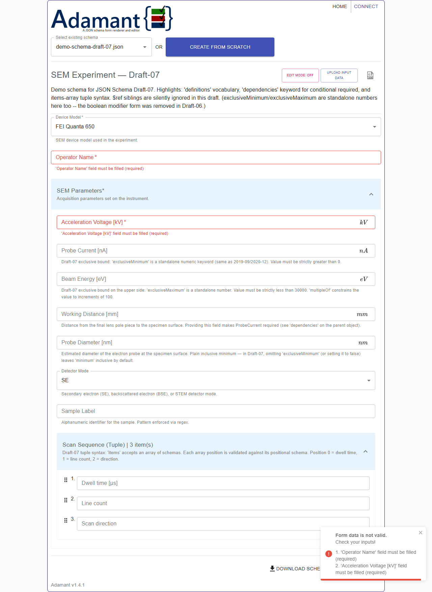

Correct the marked fields and click **PROCEED** again. An empty form cannot be submitted.

**2. Submit.** When everything is in order, a review window opens. Click **SUBMIT** to choose what to do with your data, or **CANCEL** to go back and make changes. The options under **SUBMIT** depend on how Adamant has been set up at your institution and on which accounts you have connected. Options that are not available to you are grayed out. Typical options are:

| Option | What it does | Needs |
|---|---|---|
| **Create eLabFTW Experiment** | Creates a new eLabFTW experiment from your entries. | eLabFTW connection |
| **Submit Dataset to NextCloud** | Uploads your entries, the schema, and any attached files to a NextCloud folder. | NextCloud connection |

**Uploading to NextCloud.** After you choose **Submit Dataset to NextCloud** and pick a folder, Adamant asks you to confirm the file names:

| Field | Suggested name | Notes |
|---|---|---|
| **File name** | Taken from the form's URN field, or `metadata` if the form has none. | Name of your data file. Change it if you like. |
| **Schema file name** | The file name with `-schema` added. | Updates automatically as you change the file name, until you edit it yourself. |

Click **Upload** to send the files.

---

## 6. Editing a Schema

Edit Mode lets you change the form itself: add, remove, rename, and reorder fields, or change what counts as a valid entry.

Click **EDIT MODE: OFF** above the form. It changes to **EDIT MODE: ON**.

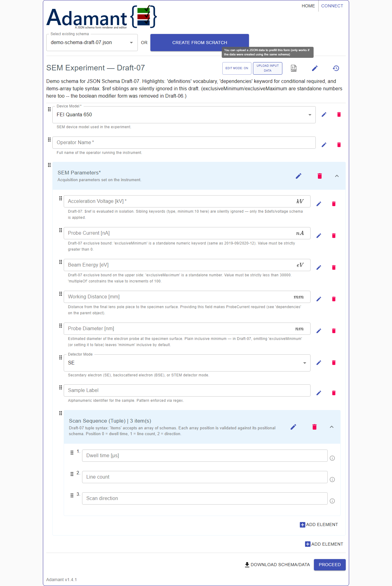

In Edit Mode:

- Each field has a **pencil** icon (edit) and a **bin** icon (delete).
- A **drag handle** (six dots) appears to the left of each field.
- **ADD ELEMENT** appears at the bottom of the form and of each section.
- Two extra icons appear next to the JSON icon: a **pencil** to edit the schema's title and description, and a **clock** icon to undo all changes.

Changes in Edit Mode only affect the form in your browser. To keep them, use **Download JSON Schema** ([Section 4.1](#41-downloading)).

### 6.1 Editing a Field

Click the pencil next to a field.

**Basic Descriptors:**

| Setting | Meaning |
|---|---|
| **Field Keyword** | The field's internal name, used in the saved data. Required and must be unique. |
| **Field ID/URI** | An optional identifier for the field. |
| **Field Title** | The label shown on the form. |
| **Field Description** | The help text shown under the field. |

**Validation Related:** choose the **Field Data Type** and set any rules for valid entries, such as a minimum or maximum, a list of allowed values, or whether the field is **Required**. The rules available depend on the type; see [Section 8](#8-field-types).

Click **Save** to apply your changes, or **Cancel** to discard them.

### 6.2 Adding a Field

Click **ADD ELEMENT** at the bottom of the form, or at the bottom of a section to add a field inside that section.

Enter a **Field Keyword**, optionally a title and description, and choose a **Field Data Type**:

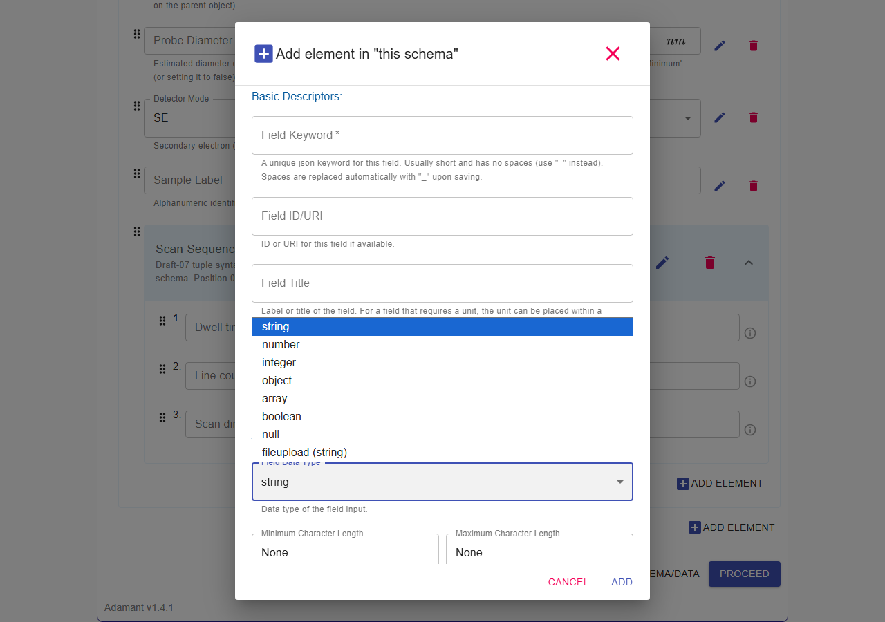

Set any rules you need and click **Add**.

### 6.3 Deleting a Field

Click the bin icon next to a field. The field is removed immediately and there is no confirmation. To get it back, undo all changes ([Section 6.6](#66-undoing-all-changes)).

### 6.4 Reordering Fields

Drag a field up or down by its six-dot handle.

### 6.5 Editing the Schema Title and Description

Click the pencil icon next to the JSON icon.

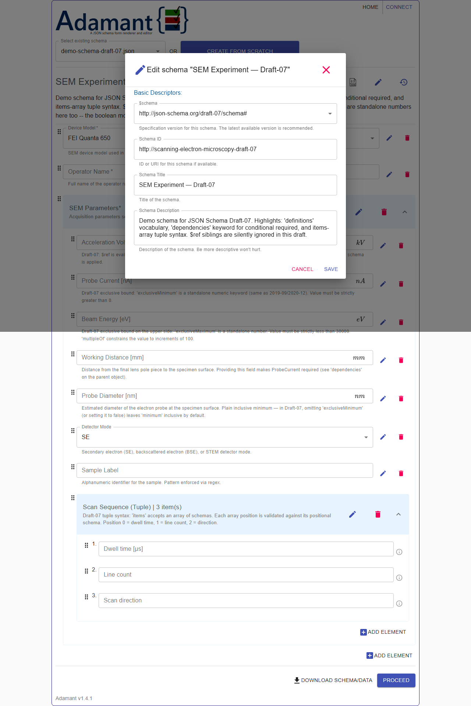

| Setting | Meaning |
|---|---|
| **$schema** | The schema version. See below. |
| **Schema ID** | An optional identifier for the whole schema. |
| **Schema Title** | The title shown above the form. |
| **Schema Description** | The text shown under the title. |

**Schema versions.** Adamant supports four versions of the JSON Schema standard: Draft-04, Draft-07, 2019-09, and 2020-12. Adamant checks your form against whichever version the schema uses. Changing the version here does not rewrite the rest of the schema, so only change it if you know the schema was written for that version. For new schemas, the latest version (2020-12) is recommended.

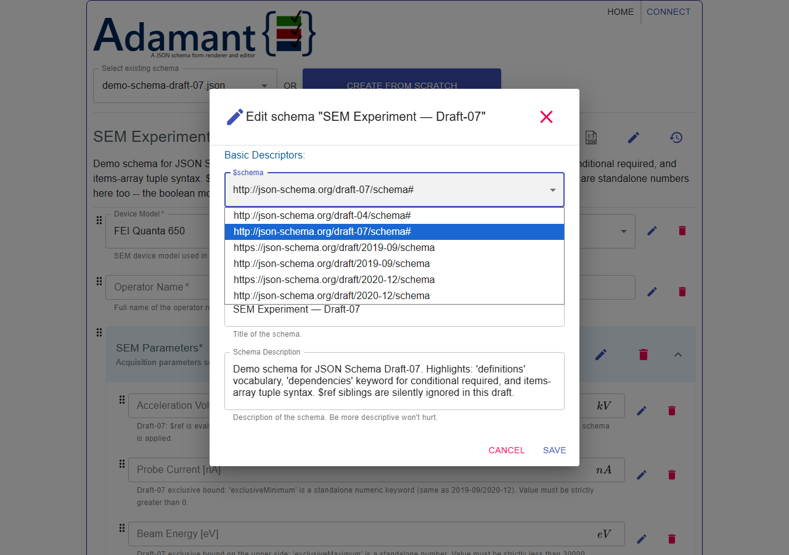

Click **Save** or **Cancel**.

### 6.6 Undoing All Changes

Click the clock icon above the form to return to the schema as it was when you loaded it.

**Note:** this also clears everything you have entered in the form. Download your data first if you want to keep it.

---

## 7. Connecting NextCloud and eLabFTW

Connecting an account lets you load schemas and data from it and send your finished data to it.

Click **CONNECT** in the top-right corner and choose **NextCloud** or **eLabFTW**. Once connected, the account appears at the top of the page with your name, and that menu entry is grayed out.

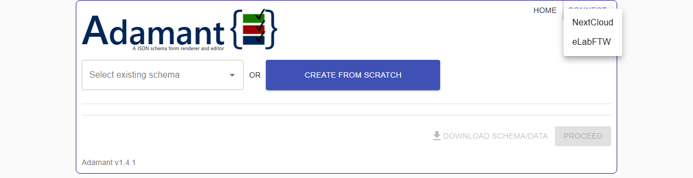

<!-- Screenshot to retake: top bar with connected accounts. -->

You can be connected to NextCloud and eLabFTW at the same time, but only to one eLabFTW instance at a time. To switch to a different eLabFTW instance, disconnect first ([Section 7.4](#74-disconnecting)).

### 7.1 eLabFTW

Click **CONNECT**, then **eLabFTW**. The **Connect with eLabFTW** window opens, where you choose which eLabFTW to connect to.

You need an eLabFTW **API token** for the instance you connect to. If you do not have one yet, log in to that eLabFTW and create an API key in your profile settings. The **More info** link in the window explains how.

**Your institution's eLabFTW**

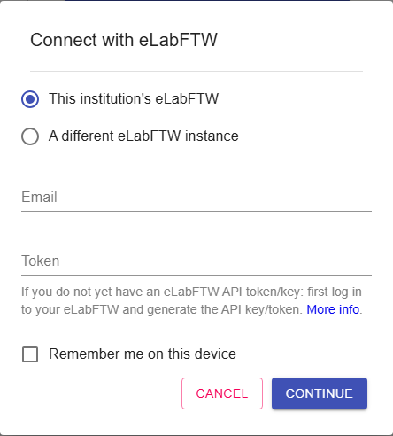

1. Leave **This institution's eLabFTW** selected.
2. Enter your **Email** and your **Token**.
3. Click **Continue**.

**A different eLabFTW instance** (for example, a partner lab's)

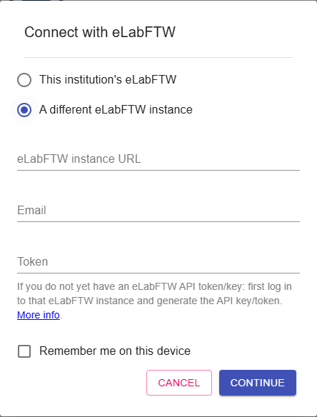

1. Select **A different eLabFTW instance**. A third field, **eLabFTW instance URL**, appears.
2. In **eLabFTW instance URL**, enter the web address of that eLabFTW, for example `https://demo.elabftw.net`. Use the address you normally open in your browser to log in.
3. In **Email**, enter the email address of the demo account. See [Finding your email and API token](#finding-your-email-and-api-token).
4. In **Token**, enter an API token created on that demo instance. See [Finding your email and API token](#finding-your-email-and-api-token).
5. Click **Continue**.

#### Finding your email and API token

You find both in the eLabFTW instance you want to connect to.

1. Log in to that eLabFTW in your browser and click your initials in the top-right corner. A menu opens.

   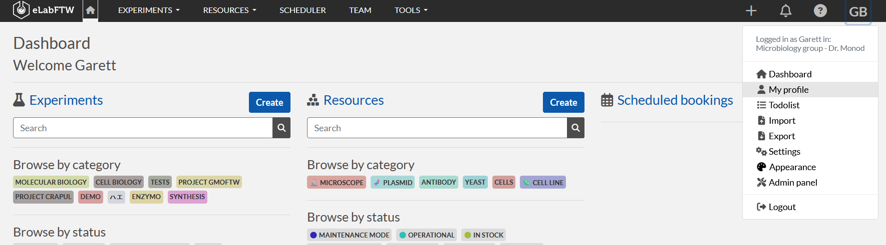

2. Click **My profile**. Your email address is shown under your name. Enter it in the **Email** field in Adamant.

   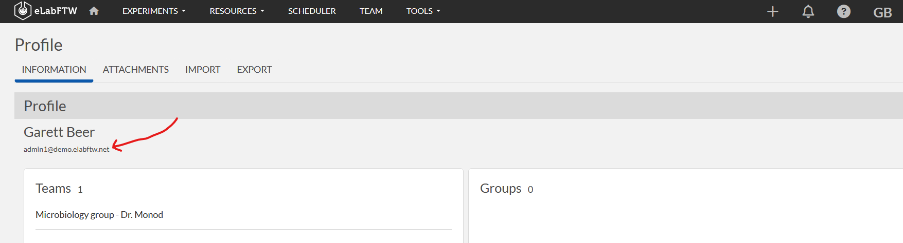

3. Open the menu again and click **Settings**, then the **API KEYS** tab.
4. Under **Create new key**, enter a **Name** (for example "Adamant"), leave **Permissions** at **Read/Write**, and click **Generate an API Key**.
5. Copy the key and paste it into the **Token** field in Adamant.

   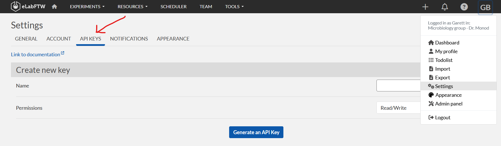

### 7.2 NextCloud

Click **CONNECT**, then **NextCloud**.

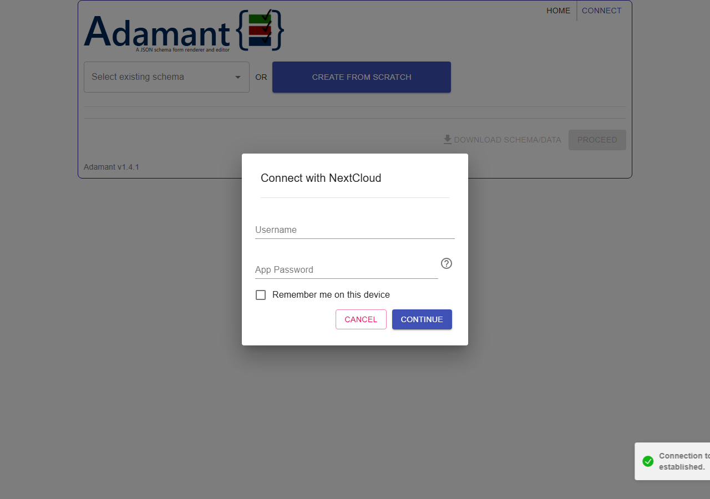

1. Enter your NextCloud **Username**.
2. Enter an **App Password**. Do not use your normal NextCloud password. To create an app password, go to NextCloud **Settings > Security > Devices & sessions**, enter a name such as "Adamant", and click **Create new app password**.
3. Click **Continue**.

### 7.3 Remember Me

Each connection window has a **Remember me on this device** checkbox.

- **Not ticked (default):** you stay connected while the browser is open, including after reloading the page. Closing the browser ends the connection.
- **Ticked:** your login is kept on this computer, even after you close the browser. To stop this, connect again with the box unticked.

Adamant doesn't store your eLabFTW token or NextCloud app password in the server. Only at the local browser storage when you click **Remember me**.

### 7.4 Disconnecting

Click the **x** on the account's name at the top of the page. When you connect again later, your login details are already filled in, so you only need to click **Continue**.

---

## 8. Field Types

| Type | Shown as | Rules you can set |
|---|---|---|
| `string` | Text box, or a drop-down list if you set allowed values | Minimum and maximum length, a required pattern, a format such as email or date, or a fixed list of allowed values |
| `number` | Number box | Minimum and maximum, and "multiple of" |
| `integer` | Number box, whole numbers only | Same as `number` |
| `boolean` | Checkbox | None |
| `object` | A section containing other fields | Its own fields, each required or optional |
| `array` | A list where you can add several entries | Minimum and maximum number of entries, no duplicates. Tick **Tuple array** to give each position in the list its own type. |
| `null` | No input | The field can only be empty |
| `fileupload (string)` | A file picker | Lets the user attach a file |

Every type can be marked as **Required**, and every field can have a description that is shown under it.
